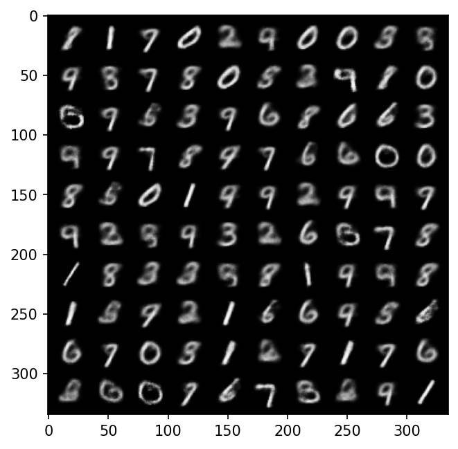
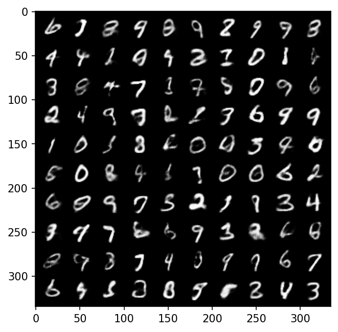
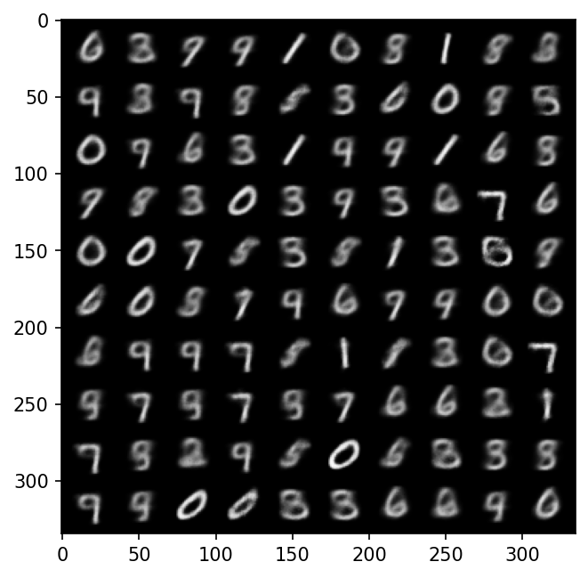
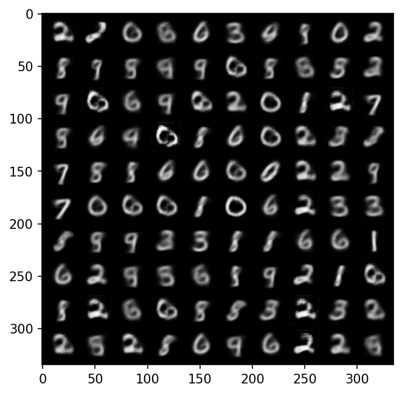

# VAE Latent-Space Experiments

AI-EDGE Summer REU, Ohio State University (Summer 2026)

Starting from a provided variational autoencoder notebook (MNIST digits), I changed one parameter at a time and measured the effect on average reconstruction error (lower is better) and on a grid of 100 generated digits.

## Results

| Run | Parameter changed | Value | Avg. reconstruction error |
|-----|-------------------|-------|---------------------------|
| 0 | Default parameters | n/a | 19058.17 |
| 1 | Latent space size | 2 -> 10 | 12427.37 |
| 2 | Variational beta | 1 -> 5 | 21240.41 |
| 3 | Learning rate | 1e-3 -> 1e-4 | 19810.45 |

## Findings

- **Latent size had the biggest effect.** Going from 2 to 10 dimensions cut reconstruction error by about 35% and made generated digits visibly sharper. More latent dimensions let the model capture more detail.
- **Higher beta made reconstruction worse.** Beta controls how strongly the latent space is pushed toward a simple distribution, so raising it from 1 to 5 traded some reconstruction accuracy for a more regular latent space. Digits were still recognizable but blurrier.
- **Lower learning rate made almost no difference.** With the number of training epochs unchanged, a 10x smaller learning rate only slowed learning, and the result was close to the default.

## Generated samples

| Default (latent size 2) | Latent size 10 |
|---|---|
|  |  |

| Beta 5 | Learning rate 1e-4 |
|---|---|
|  |  |

## Takeaway

For better generation quality in this setup, increasing latent size was the most effective of the three changes tested.

*The base VAE notebook was provided by the program; the experiments and analysis are my own.*
